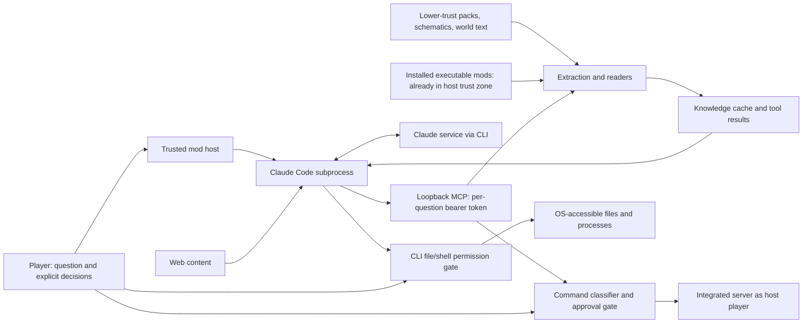

# Claude Chat threat model

## 1. Overview

Claude Chat is a client-side Fabric mod that sends a player's question and game context to a locally launched Claude Code CLI, then renders its answer in Minecraft chat. The CLI can read reference material, use web tools, and call a local MCP service. In an integrated single-player world, the service exposes world inspection and a separately authorized game-command executor. In multiplayer, local game context, mod research and the client-side `look` tool remain available; the integrated-server tools do not. An integrated world opened to LAN is still the host's world, not a multi-tenant service.

**Purpose and scope.** A reusable, repository-wide model of capabilities and trust boundaries, with particular attention to command authorization and third-party content. Its attacker stories are conditional investigation scenarios, not vulnerability reports.

**How to read the anchors.** Code is cited by class and method, not line, and each invariant names the tests that enforce it. A test fails when the code moves out from under it; a line number doesn't. File paths and layouts belong in `AGENTS.md`, which is kept current with the code. Game-test steps are named by their `CLAUDECHAT_*` switch (see `AGENTS.md`).

| Component | Role and security significance | Anchors |
| --- | --- | --- |
| Client orchestration and configuration | Captures local questions, owns the current question and its lifetime, stores the permission tier and cheats setting | `ClaudeChatClient`, `Conversation`, `ClaudeConfig` |
| Claude CLI adapter | Selects the executable, builds the prompt and flags from the question's policy, starts, streams and kills the child process and everything it started | `ClaudeCli`, `ClaudeRun`, `ProcessTree`, `PrivateFiles`, `ClaudeStream`, `SystemPrompt` |
| Permission policy | One definition per tier (CLI flags, prompt paragraph, command rule, confirmation); captured per question | `PermissionTier`, `Policy` |
| MCP service | Loopback broker; each question gets its own bearer token mapped to that question's policy; availability checked at call time | `McpServer`, `McpServer.Grant`, `Tool`, `Tool.Context` |
| Command gate and approvals | Classifies the parsed command chain, asks the player, runs the approved parse as the host player | `CommandRules`, `GameCommands`, `Approvals`, `ChatActions` |
| Knowledge base and decompilation | Extracts installed content and enabled world packs; runs bundled Vineflower; publishes searchable caches | `KnowledgeBase`, `BuiltFolder`, `Decompiler`, `KnowledgeFiles`, `DataPackCopy` |
| World, template and schematic readers | Read saved and live world state, templates and imported schematics within budgets | `WorldIndex`, `StructureFinder`, `StructureTemplates`, `Schematics`, `NbtBudget` |
| View and chat rendering | Screenshot and data export; rendering untrusted text; suggested commands and constrained waypoint actions | `ViewSnapshot`, `ChatFormatter`, `ChatMarkup`, `Waypoints` |
| Build and distribution | Trusted build resolves dependencies and bundles the decompiler; tests and extra-mod loading are developer workflows | `build.gradle` |

The CLI is an authority-bearing interpreter of model output. Its permission enforcement, the MCP broker's authorization, the integrated server's permissions and OS access controls are separate boundaries. A prompt is not a replacement for any of them.

### Capabilities by tier and deployment

| Deployment or tier | Capability | Enforcing control |
| --- | --- | --- |
| Every question | Launch the selected `claude` executable as the current OS user | Argument-list process creation; question over stdin; no OS sandbox |
| Read only (default) | File reads, search, web, MCP tools | CLI tool flags from `PermissionTier.READ_ONLY`: reads allowed only in the knowledge cache (`Read(./**)`), anything else denied (`dontAsk`); MCP handlers enforce their own operations |
| Ask for approval | Also file edits and shell commands | CLI flags route each prompt to the `approve` tool; the player decides in chat |
| Full access | Broad file and shell authority | Explicit confirm click; `bypassPermissions`; OS permissions only |
| Integrated world, any tier | Game commands | `CommandRules` classification, the tier's command rule, server permissions; cheats setting only raises the source's level |
| Each question's lifetime | Tool calls over MCP | Per-question bearer token, revoked when the question ends; token file in an owner-only per-question folder, deleted after the question |
| Decompilation and caches | Brokered writes inside the knowledge cache | Host-selected sources; link-safe walks; real-location checks; publish by rename |
| World packs, schematics, templates | Parsing lower-trust data | Byte, memory, nesting, count and archive budgets |
| Any connected world | Screenshots and view data | The `look` contract (invariant 6) |
| Optional Xaero integration | Waypoint UI action | Known-good version range; structured encoding; the player confirms in Xaero's screen |

## 2. Threat model, trust boundaries and assumptions

### Assets, actors and objectives

Protect world integrity, host files and credentials, account usage, private world, schematic and source contents, the integrity of the player's approvals, and client and server availability. Protect the binding between a question, its world, its permission policy, its pending actions and its resulting conversation.

The primary adversary controls **content the assistant may encounter**, not the player's trusted configuration: a sign or item name from another player or server, a web page, an imported schematic, or data in a user-enabled pack. To attack, that content must actually reach context, be read as reference material, or be returned by a tool. A remote player doesn't gain MCP access or the ability to send local `@claude` questions by sending chat, but incoming content can still influence a later local question.

An influenced or mistaken model can propose arbitrary tool arguments within its exposed tool set. It is not a trusted authorizer. In Full access the player has deliberately delegated much broader authority; harmful model behaviour is still a risk there, but using that granted authority is not an authorization bypass.

A local process without the current question's token may probe loopback but should not invoke tools. The identity the MCP service checks is possession of a live token, not the identity of the process. A process able to read the token file while a question runs can act as that question; this requires a concrete file-access or disclosure prerequisite. Same-user malware isolation is not a goal.

Installed **executable mods already run inside the game trust zone**. A malicious loaded mod can act with host-process authority without Claude Chat, so a report based only on such a mod executing code, changing command registration or reading files doesn't demonstrate a new privilege gain. Data-only material and a compromised model are different: turning them into OS writes, code execution or unauthorized game commands crosses a real boundary.

### Required invariants

1. **Composition-safe command authorization.** A command runs unasked only when every executable part of its parsed chain is permitted: modifiers, redirects, aliases and the final command. A read-only tail can't authorize a writing prefix (`store`, `summon`) or data-pack code (`if|unless function`). Only Minecraft's own nodes count; unknown extension behaviour fails closed. Provenance checks are compatibility safeguards, not a sandbox against hostile loaded Java.
   *Anchors:* `CommandRules.segments`, `CommandRules.readOnly`, `GameCommands`. *Tests:* `CommandRulesTest` (the real vanilla dispatcher; every known bypass shape), the `PERMISSION_TEST` game step (each shape refused in Read only, asked in Ask).

2. **Separate mutation policy from game privilege.** Read only refuses every non-read-only game command, even with cheats on. Ask requires a decision for each. Full runs them. The cheats setting only changes the command source's permission level, and cheats off doesn't mean the host lacks cheats in the world. The executor is always the owning player, including on LAN; if the host can't be identified, commands fail closed.
   *Anchors:* `PermissionTier.CommandRule`, `Policy`, `GameCommands`, `WorldIndex.host`. *Tests:* `PolicyTest` (every tier with cheats off and on), the `PERMISSION_TEST` and `RUN_TEST` game steps.

3. **Bind consent to what executes.** The payload shown for approval is the payload that runs: `run_command` runs the parse that was classified and shown, never a reparse, and refuses if the world or host changed in between; `approve` returns as `updatedInput` the very copy it displayed, and lists every field it doesn't otherwise show. An approval belongs to its question: a decision arriving after the question ended is denied, and a timeout denies. Host-created random, one-use buttons stop ordinary content from manufacturing a working Allow.
   *Anchors:* `GameCommands` (the prepared parse), `Approvals`, `ChatActions`. *Tests:* the `PERMISSION_TEST` game step (Allow and Deny clicks, the displayed extra fields, and a stale Allow clicked after `/claude reset` and after the question answered, which is refused and places nothing). The approval timeout itself (120 s) is untested.

4. **Treat third-party text as data at every tier.** Mod metadata, decompiled strings, pack files, names and signs, web results and images must not become permission grants or trusted configuration. Third-party text that reaches the system prompt sits in labelled `<game-data>` blocks that it can't close early, and the prompt says that text is data. This is guidance to the model; enforcement belongs at the tool and process boundaries above.
   *Anchors:* `PromptData`, `SystemPrompt`. *Tests:* `SystemPromptTest` (a game state that tries to close its block; the prompt names only tools that exist).

5. **Constrain brokered writes independently of CLI tiers.** Decompilation and cache maintenance, configuration persistence, the per-world visits file, per-question prompt and token files, and screenshot temporary files are intended host operations even when generic Write, Edit and shell are unavailable. Model-selected ids resolve to host-selected sources. Input paths, archive entries and links inside the cache never decide an output or deletion target: walks don't follow symbolic links or junctions, deletes remove a link rather than its target, and a folder whose real location is outside the cache is refused. Process arguments stay data. Structure searches never generate chunks.
   *Anchors:* `KnowledgeFiles`, `BuiltFolder`, `DataPackCopy`, `Decompiler`, `ModTools`, `StructureFinder`. *Tests:* `KnowledgeFilesTest`, `BuiltFolderTest`, `DataPackCopyTest` (zip-slip, junctions; symbolic-link cases need Windows Developer Mode and otherwise skip).

6. **Limit disclosure and resource use as well as mutation.** Read-only access isn't a confidentiality guarantee: excerpts, tool results and screenshots go to the model service, and web access is a separate egress channel. Imported files are parsed within budgets on decompressed bytes, estimated memory, nesting, positions and counts, and pack archives within entry and byte limits counted from bytes read; exceeding one is an error, not a hang. Cancellation stops the work, not just the wait. `look` reports what is rendered for the player: nothing too dark, too deep in water, beyond fog or effects, behind the sign face, in a container's custom name, or another player's health. Mob health, entity names and the HUD are carved out on purpose, and the screenshot includes whatever is on screen.
   *Anchors:* `NbtBudget`, `TooLargeException`, `DataPackCopy.Limits`, `BlockVolume`, `ViewSnapshot` (its Javadoc states the contract). *Tests:* `NbtBudgetTest`, `SchematicFormatsTest`, `DataPackCopyTest`, the `TEMPLATE_TEST`, `SCHEMATIC_TEST` (a decompression-bomb fixture) and `LOOK_TEST` game steps.

7. **Scope runtime authority to the active question and world.** Each question owns its process, policy, token, approvals and cancel. Disconnect, world change and reset cancel it: the process and everything it started are killed (as they are when it ends normally), the token revoked, in-flight tool calls interrupted and pending approvals denied. A stale question's result, session and late tool calls are ignored. A question keeps the policy it started with. Tool availability is checked at call time, not only when tools are listed.
   *Anchors:* `ClaudeRun`, `ProcessTree`, `Conversation`, `McpServer.Grant`, `Tool.call`. *Tests:* `ProcessTreeTest` (a child still attached; on Windows one whose parent exited), `McpServerTest` (a revoked token gets 401; closing a grant interrupts its calls; unavailable tools refused on call), the `RUN_TEST` game step (disconnect mid-question, stale token, tier change mid-question).

### Assumptions and open questions

- The game, Fabric, the bundled decompiler and the selected CLI executable are trusted components. Their specific vulnerabilities, user-installed CLI extensions and settings, and provider retention policies were not audited. Neither subprocess runs in an OS sandbox.
- **CLI read scope.** The knowledge cache is the CLI's working directory. In Read only the CLI's permission rules allow reads only there (`PolicyTest`); in Ask, reads outside it and the game folder go to the player. This is the CLI's enforcement, not an OS sandbox, and parent-directory or user-level CLI instructions and settings (including the player's own allow rules) may still load.
- **Content leaving the machine.** Storage and transport are local; the CLI sends questions, excerpts, tool results and `look` images to Claude's service. What the CLI keeps in its own history, and what the provider retains, is outside this repository.
- **Links the code can't see.** Hard links can't be detected. Junctions are detected by comparing real paths; symbolic-link tests run only with Windows Developer Mode on.
- **Budgets cover parsing, not everything.** Aggregate admission budgets (repeated expensive tool calls, total decompile work per session) aren't set; socket deadlines, tool timeouts and question timeouts are separate.

## 3. Attack surface, mitigations and attacker stories

**All rows are hypotheses for future validation.** Priority orders review attention, not confirmed severity.

| Priority | Scenario and capability gain | Prerequisites | Impact | Existing controls | Further mitigation | Anchors |
| --- | --- | --- | --- | --- | --- | --- |
| First | A hostile sign, pack string or web result persuades the model to wrap a read-only command in a mutating modifier or function; misclassification grants unapproved world mutation | Content reaches the model; integrated world; enough game permission; a classifier defect | World damage or data-pack execution in Read only or Ask | Full parse-chain classification, exact modifier shapes, vanilla-only provenance, tier gate, server permissions | Keep composition fail-closed; extend `CommandRulesTest` with every new vanilla command shape; keep risk warnings separate from permission decisions | `CommandRules`, `GameCommands` |
| First | Content-induced action continues after disconnect, reset, denial or a policy change; stale authority reaches a new question or world | An in-flight question or approval plus a lifecycle transition | Cross-world disclosure or modification; continued file or shell activity | Per-question run object, token and policy; cancel kills, revokes, interrupts and denies; late results ignored | Keep every new long-running operation inside the question's cancel; re-check at execution time | `ClaudeRun`, `Conversation`, `McpServer.Grant` |
| First | Injected content becomes file or shell instructions, or a disclosure through the CLI | Ask or Full for writes and shell; a readable sensitive file and an outbound route for disclosure; the model follows the injection | Host-file damage, unintended code execution, private-data release or account usage | Default excludes shell and writes; Ask routes to approval; Full needs a confirm click; game data marked as data in the prompt | Enforce filesystem and egress scope outside prompts where the CLI allows; keep approval payloads complete; describe Full's delegation accurately | `PermissionTier`, `Approvals`, `PromptData` |
| Next | Crafted pack paths, links or archive behaviour escape the cache or make a host reader consume unintended files | The player imports or enables attacker content; relevant filesystem or parser behaviour | Arbitrary host read or write if an escape is shown; cache poisoning otherwise | Host-selected ids, sanitized names, link-safe walks, real-location checks, archive limits | Re-check containment whenever a new write path is added; consider hard-link handling | `KnowledgeFiles`, `BuiltFolder`, `DataPackCopy` |
| Next | Untrusted input exploits decompiler parsing, or repeated decompiles exhaust resources | A reachable installed source; a parser weakness or expensive workload | Conditional host compromise; memory, CPU or disk exhaustion | Pinned bundled dependency, separate JVM, memory, thread and time caps, exclusion checks, one shared-file lock | Audit the decompiler's parser and output handling; cap aggregate decompile work | `Decompiler`, `KnowledgeBase` |
| Next | An imported schematic, template or world file expands to excessive memory or work | The file is selected or indexed | Client or server unavailability, lost unsaved work | Decompressed-byte, memory, nesting, position and count budgets; template index retries large files one at a time; cancellation inside reads | Keep new parsers on `NbtBudget`; add budgets wherever new imported formats appear | `NbtBudget`, `Schematics`, `StructureTemplates` |
| Next | Another local principal obtains a question's token and invokes tools | Reading the token file or other disclosure while a question runs | Private world or view export; permitted commands | Random per-question token, loopback bind, authentication before the body, owner-only runs and per-question folders with random names and files created new (ACL on Windows, 0700/0600 elsewhere, checked before the token is written; refused where neither exists), deletion after the question, revocation | Don't claim same-user malware isolation | `McpServer`, `PrivateFiles` |
| Next | A deceptive request or answer induces the player to approve a harmful payload | Player interaction; preview ambiguity | World or host changes under misinformed approval | Random one-use buttons; timeout denies; command shown before the model's description; marked truncation and copy-full payload; extra fields listed | Keep target identity and provenance visible in every new approval kind | `Approvals`, `ChatActions` |
| Next | Unnecessary world, schematic or view information goes to the model, or into a clickable outbound link | Tool access or frame capture; sensitive content; the model service or a clicked destination receives it | Privacy loss across the local-to-service boundary | World tools only in the integrated server; the `look` contract; links need a click | Minimize returned fields and images; keep the `look` contract tested | `ViewSnapshot`, `ChatFormatter` |
| Later | Tokenless local clients occupy HTTP workers; authenticated repeated tools consume CPU, storage or account budget | Local access for socket pressure; a token or influenced model for tools | Bounded or sustained degradation | 16-worker cap, no queue, read timeout, line, header and body limits; CLI timeout | Add aggregate admission budgets where justified | `McpServer` |
| Conditional | A compromised build dependency, executable search location or installed mod runs hostile code | The attacker controls an already-trusted supply-chain or install input | User-level host compromise | Fixed dependency declarations, explicit executable option, user-controlled installation | Protect build and release inputs and executable locations; keep this separate from data-only escalation | `build.gradle`, `ClaudeCli` |

These scenarios cover independently enforced capabilities. A `decompile_mod` request intentionally writes cache files; it doesn't imply generic shell access. The internal `approve` endpoint requests a player decision and authorizes nothing by itself, and it denies outright outside Ask. An ordinary answer's command markup suggests a command instead of running it. Xaero buttons are a separate constrained UI integration whose supported-version interception must stay valid.

## 4. Severity calibration

Severity follows demonstrated impact, reachability and *new* authority, independently of confidence. An engineering priority from an architecture review is not an automatic Critical security rating.

| Severity | Repository-specific example if established | Counterexample or factor lowering severity |
| --- | --- | --- |
| Critical | A reliable, broadly reachable data-only content path that silently produces arbitrary host execution or catastrophic credential compromise under default settings, without prior executable-mod trust or player approval | Loopback transport alone is not remote exposure. A malicious installed Java mod already running as the user doesn't establish this escalation |
| High | A content-controlled command composition bypass enabling substantial world destruction without approval in Read only or Ask, with the required game privilege; or demonstrated arbitrary sensitive-file access or write from a lower-trust import | Cheats off in a world where the host lacks the needed permissions can prevent the operation. An intentionally authorized Full action is not a permission bypass |
| Medium | Reproducible imported-file denial of service, consequential cross-world context leakage, or limited unauthorized data exposure with concrete prerequisites | A large computation chosen by the player, or information intentionally shared with Claude, is not automatically an attacker-origin violation |
| Low | Limited, recoverable cache contamination, minor information exposure or constrained local disruption with little additional authority | Cosmetic formatting differences, inaccurate non-sensitive answers and stale derived data without a security consequence are correctness issues |

For command stories, prove both the classifier decision and the sensitive operation under a reachable source permission level; accepting syntax alone is insufficient. For decompilation stories, distinguish parser input from executable code already trusted by Fabric. For file disclosure, identify the actual readable file class, the enforced CLI and OS access, and the real recipient. For consent and lifecycle stories, show which target, payload or policy changed across authorization. For exhaustion, establish input size, work amplification, concurrency and effective cancellation.

---

*Provenance.* First mapped on 2026-10-23 at commit `ce21ba0` by an independent reviewer, as architecture mapping rather than an audit; no exploit was run. Revised on 2026-10-24 against `arch-review-fixes` at `fed0d6a`, after the architectural-review fixes landed: anchors changed from line numbers to symbols and enforcing tests, the capability table was reduced to tier, capability and control, and open questions those fixes resolved became invariant text. Minecraft command semantics follow the 26.3 source, which `CommandRulesTest` loads directly.
